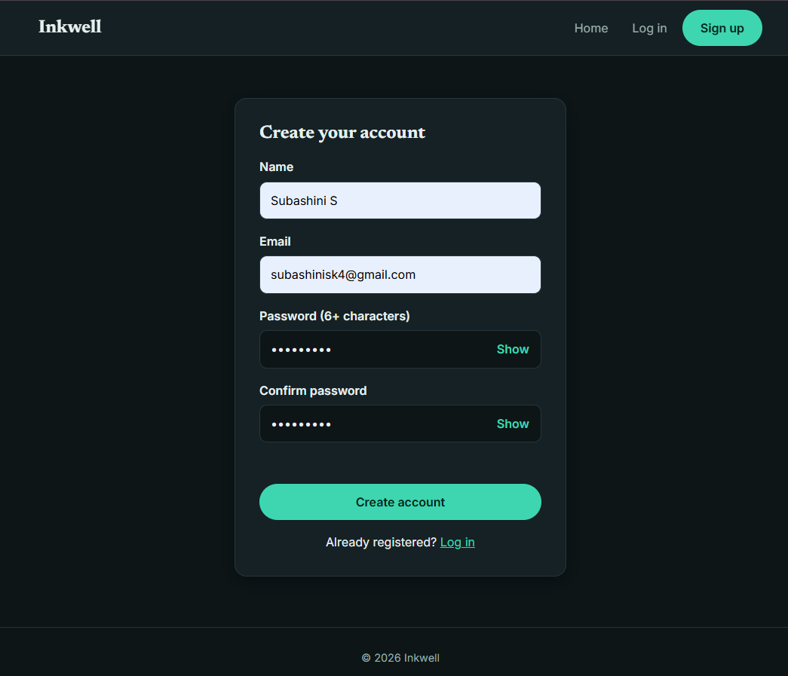
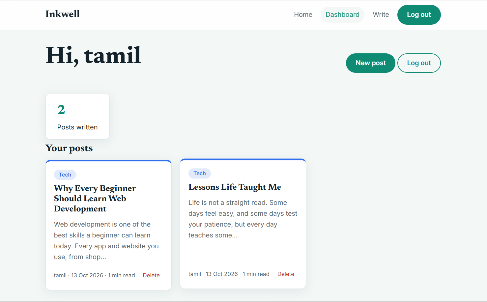
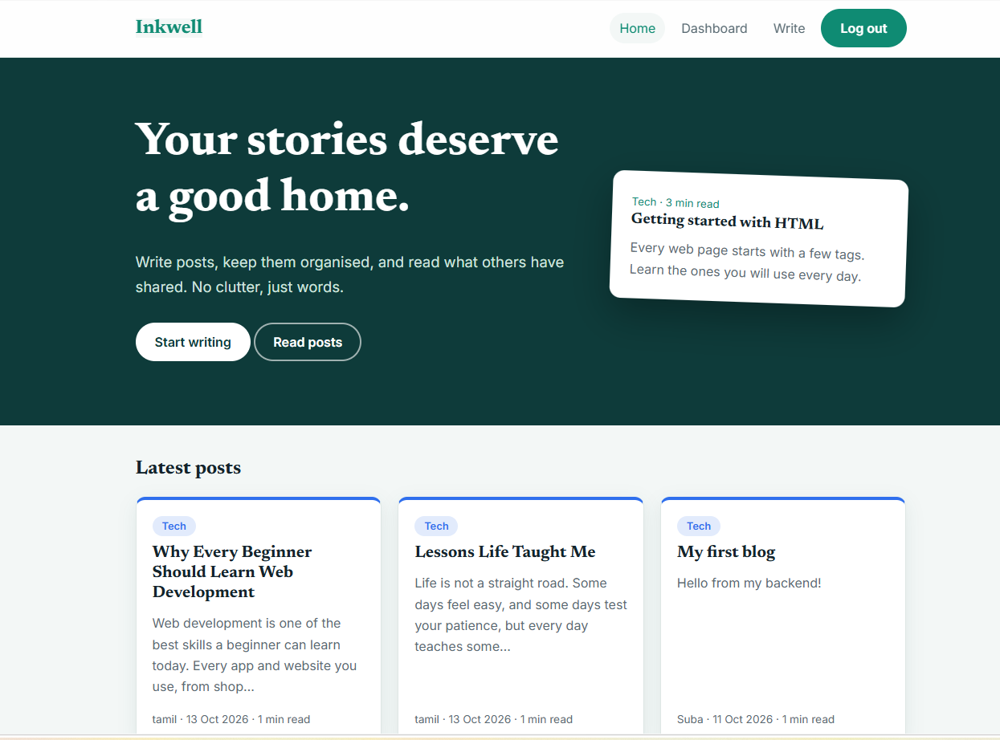

# Inkwell Blog App

A full-stack blog application. Users can register, log in and publish blog posts. The frontend (HTML, CSS, JavaScript) talks to a REST API built with Node.js, Express.js and MongoDB.

## Features
- User registration with hashed passwords (bcrypt)
- User login with JWT authentication
- Create blog posts (protected route)
- View all blogs, view your own blogs on a dashboard, delete your own posts
- Frontend connected to the backend using `fetch`

## Tech Stack
- **Frontend:** HTML, CSS, JavaScript
- **Backend:** Node.js, Express.js
- **Database:** MongoDB Atlas with Mongoose
- **Auth:** JSON Web Tokens (JWT), bcryptjs

## Project Structure
```
inkwell-blog-app/
├── backend/
│   ├── middleware/auth.js
│   ├── models/ (User.js, Blog.js)
│   ├── routes/ (auth.js, blogs.js)
│   ├── server.js
│   └── package.json
└── frontend/
    ├── index.html, register.html, login.html
    ├── dashboard.html, create-blog.html
    ├── script.js
    └── style.css
```

## API Endpoints
| Method | Endpoint | Auth | Description |
|--------|----------|------|-------------|
| POST | /api/auth/register | No | Register a user (name, email, password) |
| POST | /api/auth/login | No | Log in and receive a JWT |
| POST | /api/blogs | Bearer token | Create a blog (title, content, category) |
| GET | /api/blogs | No | Get all blogs |
| DELETE | /api/blogs/:id | Bearer token | Delete your own blog |

## How to Run Locally

### 1. Backend
```bash
cd backend
npm install
```
Create a `.env` file in the `backend` folder:
```
PORT=5000
MONGO_URI=your_mongodb_connection_string
JWT_SECRET=your_secret_key
```
Start the server:
```bash
npm run dev
```
The API runs at `http://localhost:5000`.

### 2. Frontend
Open the `frontend` folder and open `register.html` in your browser (or use the VS Code Live Server extension). Keep the backend running while you use the app.

## What I Learned
- Setting up an Express server and organising routes, models and middleware
- Hashing passwords and protecting routes with JWT
- Connecting a MongoDB Atlas database with Mongoose
- Calling REST APIs from the frontend with `fetch`

## Screenshots




## Author
Subashini S - [GitHub](https://github.com/suba-786)
